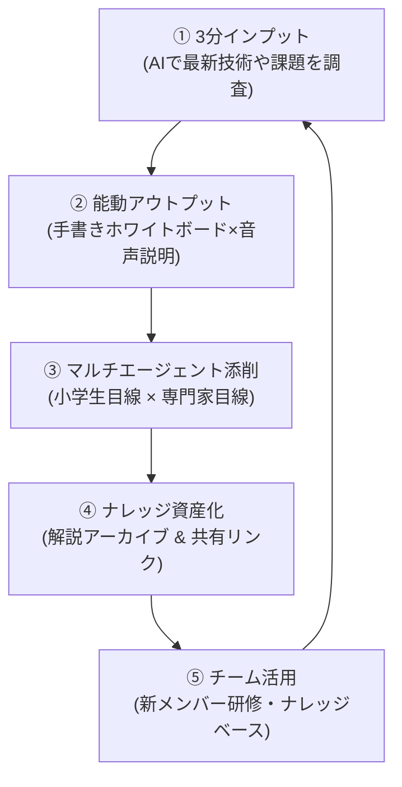
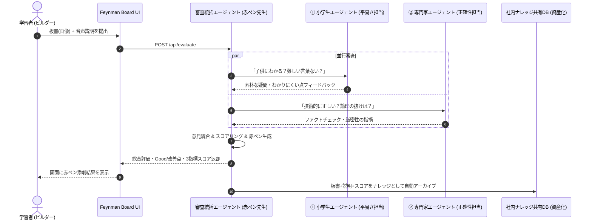
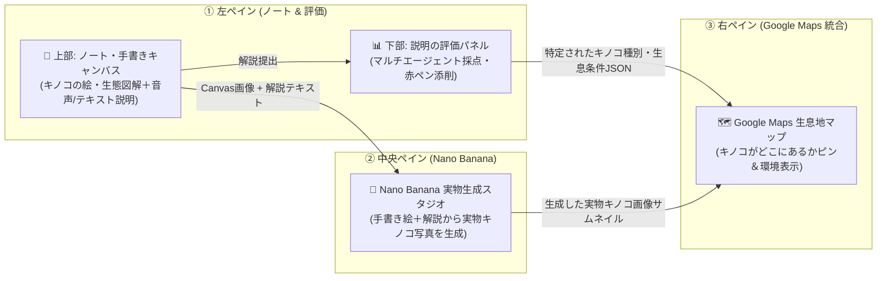

# 📘 Feynman Board（ファインマン黒板） 仕様・設計書 (SPEC.md)

> **「小学生に説明できなければ、本当に理解したとは言えない。」**  
> — リチャード・P・ファインマン (物理学者・ノーベル賞受賞者)

---

## 1. プロダクト概要 (Executive Summary)

### 1.1 背景と課題
- **AI時代の「思考停止」問題**: 生成AIが普及し、誰でも答えを瞬時に得られるようになった反面、「AIの出力を丸呑みし、人間自身が深く理解・説明できない」という課題が発生しています。
- **企業のナレッジ共有の形骸化**: ドキュメント作成は負担が重く、属人化した暗黙知が組織の資産として残りにくい。

### 1.2 ソリューション
**『Feynman Board』**は、能動的アウトプット学習法（ファインマン・テクニック）をAIでスケールさせる教育・ナレッジ資産化プラットフォームです。
ユーザーは **「3分間で調べ、ホワイトボードに図解し、声で誰かに教える」**。
裏側では **マルチモーダル・マルチエージェントAI** が、異なる視点から即座に赤ペン添削を行い、その成果物は**「社内ナレッジの共有資産」**として自動蓄積されます。

---

## 2. コア思想: 組織の暗黙知を資産化する「ファインマン・ループ」

本プロダクトの真価は、個人の学習にとどまらず **組織全体の知的生産性を高めるフライホイール（好循環）** にあります。



1. **インプット**: AIの支援を得て短時間で要点をインプット。
2. **アウトプット**: 自分の手で図を描き、自分の言葉で声に出して説明する（脳の理解度が飛躍的に向上）。
3. **客観的評価**: マルチエージェントAIが「小学生でもわかる平易さ」と「専門的正確さ」の両面から赤ペン添削。
4. **組織の資産化**: 「一番わかりやすい3分図解」が社内ギャラリーにストックされ、誰でも閲覧・検索・再利用可能に。

---

## 3. システムアーキテクチャ & マルチエージェント設計

### 3.2 パワポ風ハイブリッド・キャンバス & 動的構造解析 (PowerPoint-style Flowchart Engine)
手書き描画だけでなく、キーボードによるタイピング入力やフローチャート図形の配置に対応。直感的な操作性と、AIによる厳密な因果関係の解析を両立します。

1. **パワポ風コンポーネント配置**:
   - 🔲 **四角形ボックス（プロセス/コンポーネント）**: クリックやテンプレートで即座に配置。ドラッグで自由移動。
   - ➡️ **矢印コネクタ（データフロー/因果関係）**: 処理順序やメッセージ送受信の向きを明示。
   - 📝 **タイピング文字入力**: 選択したボックスのテキストを入力・リアルタイム編集。
   - ✏️ **フリーハンド手書きペン**: 重要部分へのアンダーラインやフリーな注記。
   - ⚡ **ワンクリック「フロー図テンプレート」**: 3ステップ（入力 ➔ AI解析 ➔ 完了）の典型的なフローを1秒でキャンバスに呼び出し。

2. **動的構造化解析 (Hybrid Multimodal + Graph Parsing)**:
   - 単なる「画像」として渡すだけでなく、キャンバス上の**ボックス一覧・矢印の接続関係・テキスト内容をグラフ構造（JSON / テキスト）として自動抽出**。
   - `【配置構造】: [ボックス1: "クライアント (SYN)"] ➔ (矢印: "① SYN") ➔ [ボックス2: "サーバー (SYN-ACK)"]`
   - これをGoogle Gemini 3.8 Flashに画像とセットで渡すことで、文字の誤認識ゼロで**因果関係の論理破綻やステップの抜け漏れをピンポイントに動的解析**します。
   - 会社の資産として保存する際も、画像PNGに加えて**図形のJSON構造データをまるごと保存**するため、他のメンバーが後から複製・編集して再利用可能です。
単一のLLMによる総花的な評価ではなく、**役割と視点の異なる3つの専門エージェント**が協調して多角的にレビューを行います。



#### 各エージェントの役割定義
| エージェント名 | ペルソナ / 役割 | 審査基準 |
| :--- | :--- | :--- |
| 👦 **小学生エージェント (The 10-Year-Old)** | 専門用語を知らない好奇心旺盛な子供 | 「日常の何に例えられるか？」「矢印の意味が直感的にわかるか？」「難解なカタカナ語がないか？」 |
| 🧑‍🏫 **専門家エージェント (Domain Expert)** | 該当地雷やアーキテクチャを熟知するプロ | 「概念に誤謬・ハルシネーションがないか？」「因果関係やトレードオフが抜けていないか？」 |
| ✍️ **赤ペン統括先生 (Lead Facilitator)** | 双方の講評をまとめ、学習者の成長を導く指導者 | 総合スコア（100点満点）、モチベーションを高める称賛、具体的で実行可能な「赤ペン改善アクション」の策定 |

---

## 4. 統合画面イメージ・UI/UX設計 (NotebookLM風 3ペイン・スプリット画面)

チームメンバーが開発した **「Google Maps キノコ生息地マップ機能」** と、**「Nano Banana による手書き絵からの実物キノコ生成機能」** を統合し、**NotebookLM** のように1画面で「思考・表現 ➔ 実物視覚化 ➔ 実地マップ探索」がシームレスに連動する **3ペイン・スプリットワークスペース** を構築します。

### 4.1 画面レイアウト全体像（ワイヤーフレーム）

各ペイン（および左下の評価エリア）には **「最大化（Maximize / Restore）ボタン `[⛶]`」** を備え、全体の連動を見渡すスプリット表示と、各作業に没入するフルスクリーン表示をワンクリックで切り替えられます。

```text
+------------------------------------------------------------------------------------------------------------------+
| 🍄 Nagano Mind (Feynman × Nano Banana × Google Maps)               [お題選択 ▼] [3分タイマー 02:45] [共有・保存] |
+------------------------------------+------------------------------------+----------------------------------------+
| 【左ペイン】ノート＆解説           | 【中央ペイン】Nano Banana 実物生成 | 【右ペイン】Google Maps 生息地マップ   |
| 📝 Note & Canvas            [⛶ 最大]| 🍌 Real Mushroom Studio     [⛶ 最大]| 🗺️ Google Maps Explorer         [⛶ 最大]|
|------------------------------------|------------------------------------|----------------------------------------|
| [選択][四角][矢印][文字][手書きペン]|                                    |  +----------------------------------+  |
| +--------------------------------+ |  +------------------------------+  |  | Google Maps (長野県全域・地形図) |  |
| | 🍄 手書きスケッチ & 図解       | |  |                              |  |  |                                  |  |
| |   ___                          | |  |   [Nano Banana 生成画像]     |  |  |      📍 上田市・真田の赤松林     |  |
| |  /   \  ← カサ（赤色・白いイボ）| |  |   手書きの絵＋説明文から     |  |  |         (発生確率: 85%)          |  |
| |    |    ← ツバがある           | |  |   超リアルな実物キノコ写真を |  |  |              📍 伊那谷・アカマツ |  |
| |  [白樺の根と共生]              | |  |   ダイナミックに生成表示     |  |  |                                  |  |
| +--------------------------------+ |  |                              |  |  |  +----------------------------+  |  |
| 🎙️ 音声/テキスト解説入力:         |  +------------------------------+  |  |  | 📍 選択スポット詳細        |  |  |
| 「白樺や赤松の根元に生えるキノコで |  ✨ 抽出された特徴タグ:            |  |  | 標高: 600-850m / 赤松林   |  |  |
|   雨の後に一斉に顔を出します…」   |  [#赤色カサ] [#白い麟片] [#菌根菌] |  |  | [Street View] [ルート検索] |  |  |
|              [🚀 AI評価＆実物生成] |  [🔄 再生成] [🔍 スケッチ比較]     |  |  +----------------------------+  |  |
|====================================|                                    |  +----------------------------------+  |
| 📊 説明の評価 (AI赤ペン添削)[⛶ 最大]|                                    |  📍 特定された生息地リスト (3件):      |
|------------------------------------|                                    |  1. 上田市・真田の赤松林 (東信) [FlyTo]|
| 🏆 総合スコア: 88点 (マツタケ/菌根)|                                    |  2. 松本市・四賀地区 (中信)     [FlyTo]|
| 👦 小学生: 「カサの絵がわかりやすい」|                                    |  3. 伊那市・高遠の混交林 (南信) [FlyTo]|
| 🧑‍🏫 専門家: 「菌根の共生関係が正確」|                                    |                                        |
| ✍️ 赤ペン: 「胞子の飛び方も足そう」|                                    |                                        |
+------------------------------------+------------------------------------+----------------------------------------+
```

### 4.2 3ペイン＋下部評価ドックの役割とデータ連動フロー



1. **【一番左（上部）】ノート＆解説エリア (`Note & Explanation Section`)**:
   - NotebookLMのソース/ノートパネルのように、ユーザーがキノコのイラストや生態フローを描きながら、マイク音声またはテキストで説明する領域。
   - 手書きペンでキノコの形（傘・柄・ツバ・生えている木）を自由にスケッチ可能。
2. **【一番左（一番下）】説明の評価パネル (`Evaluation Dock`)**:
   - 左ペインの一番下に常駐（ドック配置）し、左上で行った説明に対するAI評価（総合スコア、👦小学生エージェント、🧑‍🏫専門家エージェント、✍️赤ペン先生のフィードバック）を即座に表示。
   - 評価を見ながらすぐ上のノートや絵を手直しし、再評価を回すことができます。
3. **【真ん中】Nano Banana 実物キノコ生成エリア (`Nano Banana Visual Studio`)**:
   - 左ペインで描いた「手書きの絵（Canvas Image）」と「説明内容」を **Nano Banana（Gemini 画像生成モデル）** に渡し、図鑑やネイチャーフォトのような**「実物のキノコ画像」**を生成して大きく表示。
   - 「自分が描いた絵が本物のキノコになるとどう見えるか」を直感的に確認でき、手書き絵とのオーバーレイ比較や再生成も可能。
4. **【一番右】Google Maps キノコ生息地マップ (`Google Maps Habitat Explorer` - チームメンバー統合機能)**:
   - チームメンバーが開発した **Google Map 上でキノコの生息場所を表示する機能** を右ペインに統合。
   - AIが特定したキノコの種類や生息条件に基づき、Google Map上の該当スポット（長野県内の赤松林・ブナ林など）へ自動でピンを落とし、カメラがスムーズにズーム移動（FlyTo）します。
   - マップ上のピンをクリックすると、生息環境データに加えて中央ペインで生成した「Nano Banana 実物キノコ画像」もプレビュー表示されます。

### 4.3 個別最大化（Maximize / Focus Mode）とウィンドウ操作仕様

各領域のヘッダー右上に **最大化トグルボタン** を配置し、用途に応じてレイアウトを動的に切り替えられます。

| 表示モード | 画面比率（横幅 / 高さ） | 主な利用シーン |
| :--- | :--- | :--- |
| **標準スプリット表示 (Default)** | 左 `35%` : 中央 `30%` : 右 `35%`<br/>（左ペイン内は 上部ノート `60%` : 下部評価 `40%`） | NotebookLMのように「ノート解説・AI評価・Nano Banana実物画像・Google Map」の4要素を一望しながら連動させる基本モード |
| **左ペイン（ノート）最大化** | 左ノート `100%`（他ペインは最小化タブ化） | キャンバスで大きくキノコの絵やフロー図を描き込みたい時、プレゼンで板書を見せたい時 |
| **左下（評価パネル）最大化** | 左下評価パネルを全画面（または左ペイン100%）に拡大 | 3人のAIエージェントからの詳細な赤ペン添削コメントや改善アドバイスをじっくり読み込む時 |
| **中央ペイン（Nano Banana）最大化** | 中央 `100%` | 生成された実物キノコの高解像度ビジュアルや、手書きスケッチとの比較を大画面で鑑賞・発表する時 |
| **右ペイン（Google Map）最大化** | 右 `100%` | チームメンバーのGoogle Map機能をフルスクリーンで操作し、地形・衛星写真・広域のキノコ生息ピンを本格的に探索する時 |

### 4.4 チームメンバーの Google Map 機能との統合インターフェース

チームメンバーの実装形態に合わせて、以下のいずれか（またはハイブリッド）で右ペインにシームレス統合します。

1. **React コンポーネント直接統合（推奨）**:
   - `<MushroomGoogleMap spots={evaluation.habitatLocations} mushroomImage={nanoBananaImageUrl} isMaximized={activePane === 'map'} />` のように Props で生息地データと Nano Banana 生成画像をリアルタイム注入。
2. **iframe / URL / JSON メッセージ連携**:
   - 別リポジトリ・別デプロイ環境のまま統合する場合は、`window.postMessage` または共有 JSON スキーマでピン座標リスト（`spots: [{ latitude, longitude, title, condition, probability, generatedImage }]`）を右ペインの Google Map へ即時送信。

---

## 5. 他者共有 & 会社の資産化機能 (Knowledge Hub)

### 5.1 他の人への公開・閲覧（共有URL）
- **ワンクリック共有リンク**: 各セッション（板書＋音声書き起こし＋AI添削）に一意のURLを発行。
- **Slack / Teams連携**: 評価完了後、「#tech-knowledge チャンネルに共有」ボタンでサマリを即座に通知。

### 5.2 社内ナレッジギャラリー (Company Board Gallery)
- **「みんなの3分黒板」一覧**: 社内メンバーが作成した板書が並ぶカード型タイムライン。
  - お題タグ検索（例：`#Docker`, `#マルチエージェント`, `#AWS`）
  - スコア上位（殿堂入り黒板）のピックアップ
- **ピアレビュー（社内同僚からの赤ペン）**:
  - AIだけでなく、人間のシニアエンジニアやチームメンバーも「ここ分かりやすい！」「実務だとこういうケースもあるよ」とコメントや追加の赤ペンを入れられる仕組み。

---

## 6. 技術スタック (Tech Stack)

| レイヤー | 採用技術 | 選定理由 |
| :--- | :--- | :--- |
| **フロントエンド** | Next.js 14 (App Router), React, Tailwind CSS | 3ペイン・スプリットUI、個別最大化アニメーション、高速プロトタイピング |
| **描画キャンバス** | HTML5 Canvas API (カスタム最適化) | 依存ライブラリ不要で軽量・高レスポンス・画像変換容易 |
| **音声認識** | Web Speech API (ブラウザ標準) | 外部APIキー不要・低遅延なリアルタイム書き起こし |
| **AI推論エンジン** | Google Gemini Flash (マルチモーダル) | 板書画像＋音声テキストの超低遅延・高精度マルチモーダル解析＆生息地特定 |
| **実物キノコ画像生成** | **Nano Banana** (Gemini Image Generation) | 左ペインの手書きキノコ絵＋解説からリアルな実物キノコ画像を中央ペインに生成 |
| **生息地マップ統合** | **Google Maps API** (チームメンバー開発モジュール統合) | 右ペインにてキノコの生息地ピン・植生・発生確率をインタラクティブに表示 |
| **マルチエージェント** | Structured Output (JSON Schema) による協調推論 | 軽量かつ決定的な多面的フィードバックの実現 |
| **デプロイ環境** | Google Cloud Run / Vercel | 即時世界公開・SSL標準対応・サーバーレスコンテナ稼働 |

---

## 7. 今後のロードマップ (チーム統合〜製品化)

1. **フェーズ1（現在完了）**: ローカルMVP＆Cloud Run稼働（手書きキャンバス＋タイマー＋音声文字起こし＋マルチエージェント添削基盤）
2. **フェーズ2（直近：チーム統合フェーズ）**: 
   - **NotebookLM風 3ペイン・スプリットUI & 個別最大化（Maximize）機能**の実装
   - **中央ペイン：Nano Banana** による手書きスケッチからの実物キノコ画像生成の組み込み
   - **右ペイン：チームメンバーの Google Maps キノコ生息地表示機能** の統合
3. **フェーズ3（次世代）**:
   - 社内Notion / Slack / GitHub Enterpriseとの双方向ナレッジ同期
   - 発表音声と描画ストロークのリアルタイム・タイムラプス再生機能
